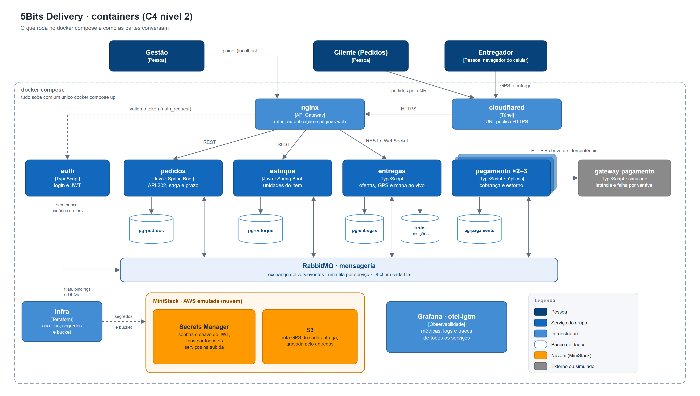

# 5Bits Delivery

Sistema de delivery com **estoque limitado** e **entregador no mapa em tempo real**. Trabalho final de Sistemas Distribuídos (FURB).

O cliente pede o item na interface **Pedidos** (a entrega vai para onde ele está, pelo GPS do celular dele). O item tem **10 unidades**: cada pedido reserva uma e, quando elas acabam, o pedido termina como esgotado. O sistema cobra num gateway lento e instável e, se tudo der certo, o pedido aparece para os entregadores: **o primeiro que tocar em Aceitar leva**. O celular do entregador manda o **GPS real pelo navegador** e o **painel de gestão** mostra a moto andando até o cliente. Se o pagamento falha ou demora, o sistema desfaz o que já fez (devolve a unidade, estorna a cobrança).

| As 3 interfaces | Quem usa | O que faz |
|---|---|---|
| **Gestão** (`/painel/`) | quem apresenta, no notebook e no telão | as **entregas ao vivo no mapa, com o GPS** dos entregadores, a lista de pedidos, o estoque do item, o **pedido manual** pelo mapa, o QR da plateia e o botão dos testes de falha do professor |
| **Entregador** (`/entregador/`) | o entregador, no celular | fica Disponível, aceita um pedido e leva até o cliente; o celular envia o GPS |
| **Pedidos** (`/cliente/`) | a plateia, pelo QR code | pede o item e acompanha o pedido passo a passo |



| Serviço | Linguagem | Faz o quê |
|---|---|---|
| `pedidos` | Java | recebe o pedido (responde `202` na hora) e coordena a saga |
| `estoque` | Java | reserva as unidades do item, sem nunca vender a mesma duas vezes |
| `pagamento` | TypeScript | cobra e estorna no gateway; roda com 2 réplicas |
| `entregas` | TypeScript | oferece o pedido aos entregadores (quem aceitar primeiro leva), recebe o GPS e mostra o mapa ao vivo |
| `auth` | TypeScript | login e JWT |
| `gateway-pagamento` | TypeScript | a "operadora" externa simulada: latência e falha configuráveis |

Por trás: RabbitMQ (mensageria), um Postgres por serviço, Redis (posições do GPS), Nginx (entrada única), **MiniStack** (AWS emulada: Secrets Manager e S3, criados por Terraform) e Grafana (métricas, logs e traces).

Quer entender cada tela? [docs/GUIA_DAS_TELAS.md](docs/GUIA_DAS_TELAS.md). Vai apresentar? [docs/ROTEIRO_APRESENTACAO.md](docs/ROTEIRO_APRESENTACAO.md). Decisões e contratos: [docs/ESPECIFICACAO.md](docs/ESPECIFICACAO.md).

---

## 1. Subir o sistema (do zero)

**Precisa de:** Docker Desktop aberto, com 6 GB de memória (Settings → Resources), e o Git. No Windows, rode os comandos pelo **Git Bash**.

```bash
cp .env.example .env              # os valores de exemplo já funcionam
docker compose up -d --build      # a primeira vez leva de 5 a 10 minutos
docker compose ps                 # tudo "healthy" (o "infra" aparece "Exited (0)": é normal)
```

Atalho que faz os três e espera ficar pronto: `./demo.sh subir`.

| O quê | Onde | Usuário / senha |
|---|---|---|
| Entrada (gestão e entregador) | http://localhost:8080 | `admin` ou `entregador1`, senha `admin`: cada um vai para a sua tela |
| Painel de gestão | http://localhost:8080/painel/ | `admin` / `admin` |
| Entregador (celular) | `/entregador/` | `entregador1` e `entregador2`, senha `admin` (duas contas: uma na tela da aula, outra no celular de um integrante) |
| Pedidos (plateia, pelo QR) | `/cliente/?codigo=promo` | sem usuário; o código do link (`promo`) é o `EVENTO_CODIGO` do `.env` |
| Grafana (uma tela só) | http://localhost:3000 | abre direto, só leitura (sem login) |

## 2. Ver funcionando

```bash
./demo.sh teste
```

Um cliente pede (com endereço), o entregador 2 aceita e "dirige" até o destino (o teste faz o papel do celular) e o pedido termina `ENTREGUE` (a rota fica no S3). No fim: **`SMOKE: PASSOU`**. Deixe o painel aberto para ver a moto 🛵 andar e rode com os celulares dos entregadores fechados.

Depois, abra `http://localhost:8080/cliente/?codigo=promo`, toque em **Pedir item** e permita a localização: recebido → unidade reservada → pagando → procurando um entregador. Depois das 10 unidades, o pedido termina como "Item esgotado". Em outra aba, entre em `/entregador/` como `entregador1`, toque em **Disponível**: o pedido aparece e, ao tocar em **Aceitar**, o cliente vê "Entregador a caminho". No Grafana (http://localhost:3000), na tabela "Pedidos recentes", clique no número do pedido: aparece o caminho dele por cada serviço (espere uns 20 s).

## 3. Celular do entregador (GPS real)

Não precisa instalar nada: o entregador abre um **link no navegador do celular**. O navegador só libera o GPS em páginas `https://`, por isso o sistema abre um túnel gratuito da Cloudflare:

```bash
./demo.sh link
```

Ele mostra os links completos. No celular (use os dados móveis ou o Wi-Fi, tanto faz):

1. Abra o link do **entregador** (`https://…trycloudflare.com/entregador/`) e entre com `entregador2` / `admin` (o `entregador1` fica na tela da aula). Se abrir só o endereço do túnel (sem o final), cai na tela de **Entrada**: entre com o mesmo usuário e você vai para a tela do entregador.
2. Toque em **Disponível** e **permita a localização** quando o navegador perguntar.
3. O cartão "GPS enviando" fica verde. No painel do notebook (abra o link do **painel**), o 🛵 aparece e anda com você.
4. Em outro celular (ou outra aba), abra o link de **Pedidos** (`…/cliente/?codigo=promo`), toque em **Pedir item** e permita a localização. No celular do entregador o pedido aparece na lista (aviso na tela, vibração e som): toque em **Aceitar**. O celular mostra o endereço do cliente no mapa e a distância; chegando a menos de 50 m, o pedido vira `ENTREGUE` sozinho (ou toque em **Confirmar entrega**).
5. Com os **dois entregadores** (`entregador1` e `entregador2`) Disponíveis, os dois veem o pedido: quem tocar primeiro em **Aceitar** leva, e o outro avisa que já foi aceito.

**QR para a plateia:** na aba **QR** do painel de gestão, o QR leva quem o lê para a página de Pedidos. Com o painel aberto pelo link do túnel, ele já aponta para o endereço público (aberto por `localhost`, aparece um campo para colar o link do túnel). Use o **Modo telão** para mostrá-lo em tela cheia.

Mantenha a página aberta e a tela ligada: é ela que envia o GPS (o navegador para o GPS quando a tela apaga). Se o GPS falhar, o plano B é `./demo.sh simular`: ele entra como o entregador 2, aceita o pedido que estiver esperando e "dirige" a rota do ensaio (feche a página do celular antes, para só uma fonte enviar o GPS).

> O túnel muda de endereço toda vez que reinicia: ligue uma vez e não mexa mais. Algumas redes (faculdade) bloqueiam a porta dele (7844): teste antes e, se preciso, use o roteador do celular no notebook.

## 4. Testes

```bash
./demo.sh unitarios      # testes do código (bibliotecas e serviços), em containers, ~3 min: TESTES: PASSOU
./demo.sh falha 1        # um cenário de falha do professor (1 a 8)
./demo.sh falha todas    # todos em sequência (~14 min)
./demo.sh testes         # abre a tela de testes de falha (http://localhost:8099, só no notebook): um botão por teste
./demo.sh estado         # containers, filas, DLQs, pedidos, estoque e outbox
```

Cada cenário mostra o **esperado** e o **obtido**, termina com **PASSOU** ou **FALHOU** e diz o que **mostrar agora**. Rode **um de cada vez**; `./demo.sh falha` sem número mostra a lista e pergunta qual. Para acionar com **botões**, abra http://localhost:8099 (o `./demo.sh subir` já liga essa tela; o painel de gestão aberto por localhost tem um botão para ela). Para cada falha a tela mostra **como o erro é provocado**, **onde ele acontece**, **o que acontece** e o **resultado esperado**, e o botão roda o teste e mostra o que aconteceu. A mesma página abre só para leitura em `/testes/` (inclusive pelo link público): os botões ficam desligados, porque os testes derrubam serviços de verdade e só funcionam em http://localhost:8099. Cada teste começa com o banco zerado. A cola para o dia em que o professor escolher está em [docs/FALHAS.md](docs/FALHAS.md).

| # | Cenário | O que o script faz | Resultado esperado |
|---|---|---|---|
| F1 | Compensação | gateway falhando 100% | pedido cancelado, unidade devolvida |
| F2 | Serviço morre no meio | `docker kill` na réplica do pagamento que pegou a mensagem | a outra réplica assume, uma cobrança só |
| F3 | Mensagem duplicada | mesma mensagem 5 vezes | um efeito só |
| F4 | Mensagem venenosa | payload inválido | 3 tentativas e DLQ; as demais seguem |
| F5 | Corrida pelo estoque | 100 clientes para 10 unidades | exatamente 10 confirmados e 90 esgotados |
| F6 | Broker fora | RabbitMQ parado por 30 s com carga | API segue aceitando, outbox drena, nada se perde |
| F7 | Resposta tardia | gateway mais lento que o prazo | cancela no prazo e depois estorna |
| F8 | Escala | 3 réplicas do pagamento | carga dividida, sem pagamento duplicado |

Para mudar o gateway na hora, sem editar o `.env`:

```bash
GATEWAY_TAXA_FALHA=30 GATEWAY_LATENCIA_MS=2000 docker compose up -d gateway-pagamento
docker compose up -d gateway-pagamento    # volta ao que está no .env
```

## 5. Antes de apresentar

```bash
./demo.sh limpar       # começa limpo: apaga os pedidos, as entregas e os pontos de GPS do ensaio e repõe as 10 unidades (nada reinicia: o link do túnel não muda)
./demo.sh estado       # confere que está tudo no ar
```

Durante a apresentação, `./demo.sh reset [N]` só repõe as unidades (por exemplo `./demo.sh reset 25` antes do QR).

Suba tudo **uma vez com boa internet antes do dia** (a primeira subida baixa imagens, Maven, npm e os providers do Terraform; depois fica tudo em cache). No dia, os mapas e o túnel precisam de internet.

No `.env`, ajuste `ORIGEM_LAT` e `ORIGEM_LON` para o local da apresentação (clique com o botão direito no Google Maps e copie). Para uma apresentação pública, troque também as senhas e o `EVENTO_CODIGO`.

## 6. Bônus

Cada bônus só vale se for demonstrado. Os dois serviços extras ficam no profile `bonus` (desligados por padrão):

| Bônus | Como demonstrar |
|---|---|
| Tracing distribuído | Grafana → clique no número de um pedido: o caminho dele por todos os serviços |
| Infraestrutura como código | `./scripts/bonus/recriar-infra.sh`: o Terraform destrói e recria segredos, bucket, tabela e filas ao vivo |
| Versionamento de eventos | `./scripts/bonus/versionamento.sh`: `pedido.confirmado` v1 e v2 convivem; o estoque nunca foi alterado |
| CQRS | `docker compose --profile bonus up -d --build consultas`; depois abra o painel ou a página do cliente com `?leitura=consultas` no endereço: a leitura passa a vir da visão separada (DynamoDB). Sem o `?leitura=…` lê do `pedidos` (Postgres) |
| Autoescala | `./scripts/bonus/autoescala.sh`: com carga, o `autoscaler` sobe réplicas do pagamento e depois remove |

## 7. Se der problema

| Sintoma | O que fazer |
|---|---|
| `docker compose` não funciona | abra o Docker Desktop e espere ficar "running" |
| Serviço `unhealthy` ou reiniciando | dê 6 GB ao Docker e rode `docker compose up -d` de novo |
| Porta 8080 ou 3000 ocupada | mude `NGINX_PORTA` no `.env` ou feche o programa que usa a porta |
| `.sh` não abre ou dá erro com `\r` | use o **Git Bash**; se persistir: `git config --global core.autocrlf input` e clone de novo |
| Pedido fica em "Aguardando entregador" | ninguém aceitou: o entregador precisa estar **Disponível**, com a página aberta, e tocar em **Aceitar** (ou use `./demo.sh simular`) |
| Entregador preso em "Em entrega" (esqueceu de concluir) | ele toca em **Confirmar entrega**; ou `./demo.sh limpar`, que zera tudo |
| Pedidos velhos do ensaio na tela | `./demo.sh limpar` |
| Pedidos caem em `ESGOTADO` | `./demo.sh reset` |
| Celular não manda o GPS | a página tem de estar em `https://` (link do túnel) e a localização liberada no navegador; o cartão do GPS diz o que falta |
| Marcador do entregador parado | tela do celular apagou ou a página foi para segundo plano: abra de novo |
| Grafana sem o caminho do pedido | espere ~20 s e aumente o período (canto superior direito) |
| Troquei a senha de um banco ou do RabbitMQ no `.env` | essas senhas ficam gravadas nos volumes: `./demo.sh apagar` e suba de novo |
| `infra` termina com erro | MiniStack ou RabbitMQ ainda subindo: `docker compose logs infra` e rode `docker compose up -d` de novo |

Parar: `./demo.sh parar` (guarda os dados) ou `./demo.sh apagar` (recomeça do zero). Logs de um serviço: `docker compose logs -f pedidos`.

## 8. Onde está cada requisito do enunciado

| # | Requisito | Onde | Como mostrar |
|---|---|---|---|
| R1 | Entrega at-least-once com idempotência | inbox (`mensagens_processadas`) na mesma transação do efeito + outbox, na `commons` de cada linguagem | F3 |
| R2 | Zero venda dupla sob carga | `UPDATE … WHERE disponivel > 0` no estoque | F5 |
| R3 | API assíncrona (`202` + id) | `POST /api/pedidos` e `GET /api/pedidos/{id}` | página do cliente |
| R4 | Consumidores concorrentes | `pagamento` com 2 réplicas na mesma fila | F2 e F8 |
| R5 | Dependência instável por variável de ambiente | `GATEWAY_LATENCIA_MS` e `GATEWAY_TAXA_FALHA` | F1 e F7 |
| R6 | Reconexão ao broker | Spring AMQP e `amqp-connection-manager` | F6 |

## Comandos úteis

```bash
docker compose logs -f pedidos              # logs de um serviço
docker compose up -d --scale pagamento=3    # mais réplicas do pagamento
docker compose restart estoque              # reinicia um serviço
./scripts/bonus/recriar-infra.sh            # o Terraform recria segredos, bucket e filas do zero
```

## Estrutura

```
contracts/        AsyncAPI e JSON Schemas das mensagens
docs/             especificação, guia das telas, roteiro da apresentação e diagramas
nginx/            API Gateway (entrada única, autenticação, rate limit)
web/              painel de gestão, página do entregador, página de pedidos (cliente)
services/java/    pedidos e estoque (+ commons) e o Dockerfile que constrói cada um (`SERVICO=nome`)
services/ts/      auth, pagamento, gateway simulado, entregas, simulador (+ commons) e o Dockerfile deles; bônus: consultas e autoscaler
infra/            Terraform (segredos, bucket, filas) e configuração do RabbitMQ
observabilidade/  Prometheus e o painel do Grafana (uma tela só)
carga/            testes de carga (k6)
simulador/rotas/  rotas GeoJSON do simulador
scripts/          cenários de falha (falhas/), bônus e utilitários
demo.sh           atalhos: subir, link, reset, limpar, teste, falha, testes, estado, parar
```

## Equipe

| Integrante | Responsável por |
|---|---|
| | |
| | |
| | |
