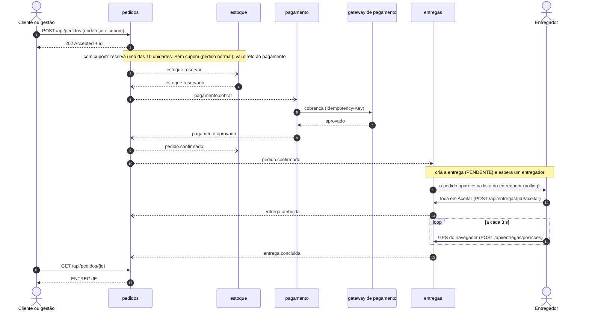
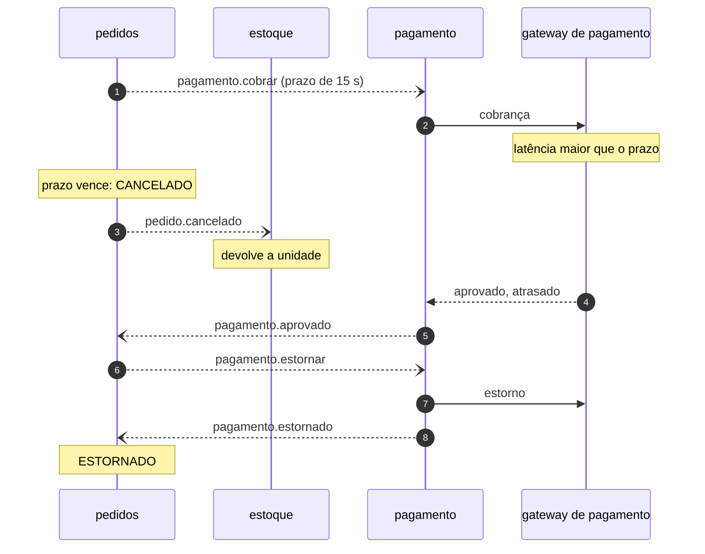
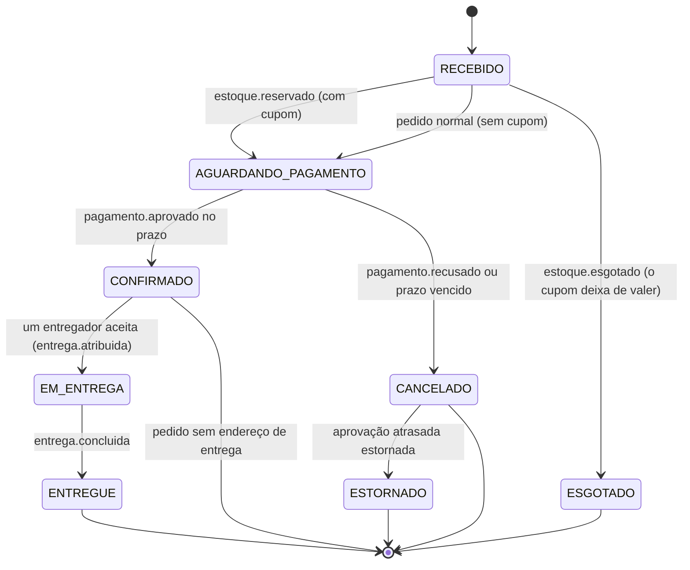
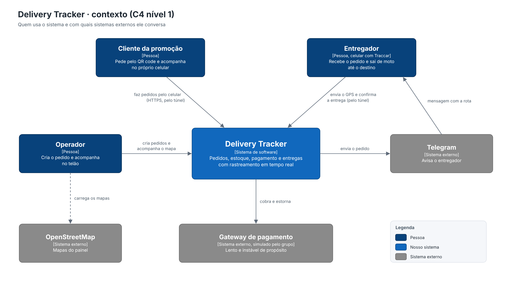
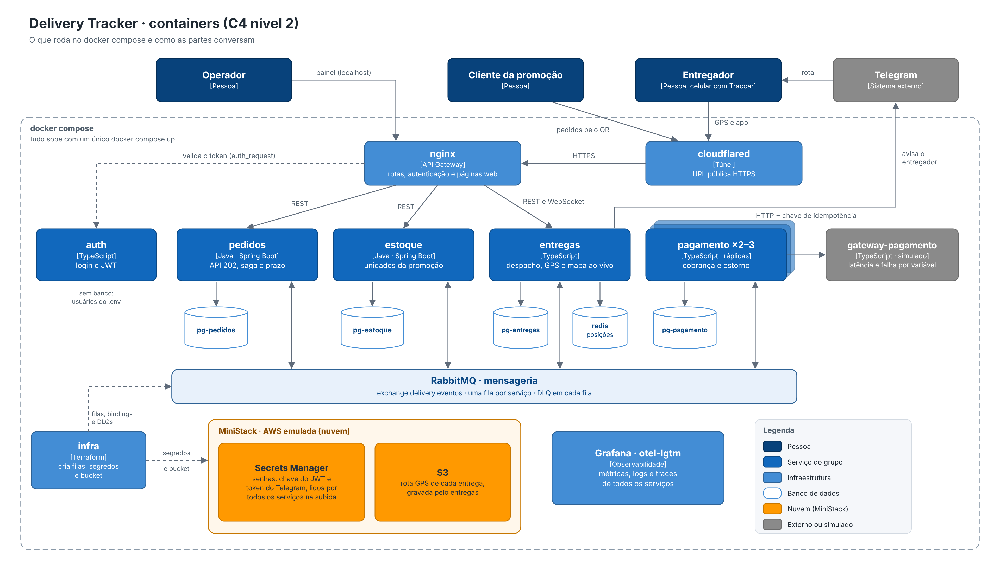
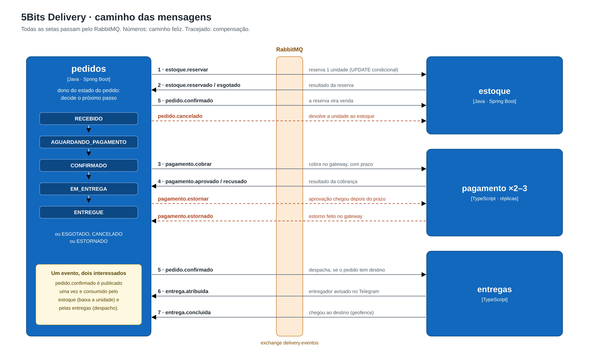

# Especificação técnica — 5Bits Delivery (v2)

Documento de referência do trabalho final de Sistemas Distribuídos (FURB): arquitetura, contratos, padrões de confiabilidade e decisões. Mudou alguma decisão? Atualize aqui junto com o código. Como subir e como apresentar: [README](../README.md) e [ROTEIRO_APRESENTACAO](ROTEIRO_APRESENTACAO.md).

**Princípio:** simples, funcionando e fácil de explicar. Cada requisito do enunciado tem um lugar claro no código e um jeito de ser mostrado ao vivo.

---

## 1. Conceito

Um sistema de delivery com promoção relâmpago e rastreamento do entregador em tempo real.

**Em um minuto:** o pedido entra e recebe na hora um número de acompanhamento. Por trás, ele passa por três etapas: o estoque separa uma das 10 unidades da promoção (só quando o pedido usa o cupom `#promobcc`; o pedido normal pula essa etapa), o pagamento cobra num gateway externo lento e instável e, se tudo der certo, a entrega fica esperando um entregador: o pedido aparece no celular dos entregadores e o primeiro a tocar em **Aceitar** leva. Ele é acompanhado no mapa até o endereço do cliente (o GPS do celular do cliente). Se o pagamento falha ou demora demais, o sistema desfaz o que já fez: devolve a unidade ao estoque e, se a cobrança passou, estorna.

O que o trabalho demonstra:

- Serviços em duas linguagens (Java e TypeScript) que só conversam por contratos.
- Transação distribuída com compensação (saga orquestrada).
- Mensageria com RabbitMQ: outbox, idempotência, retry com DLQ, réplicas concorrentes e reconexão.
- Controle de concorrência no recurso escasso (unidades da promoção).
- Nuvem: Secrets Manager e S3 no MiniStack, criados por Terraform.
- Métricas, logs e tracing distribuído no Grafana, mostrando cada passo.
- Tudo sobe com um `docker compose up`.

---

## 2. Fluxo principal

1. O pedido entra por `POST /api/pedidos`. O serviço de pedidos grava o pedido como `RECEBIDO` e responde `202 Accepted` com o id. **Com o cupom da promoção** ele deixa o comando `estoque.reservar` na outbox (mesma transação). **Sem cupom** (pedido normal) o pedido pula o estoque: vai direto para `AGUARDANDO_PAGAMENTO` e o comando `pagamento.cobrar` é que fica na outbox.
2. (Só pedido com cupom.) O estoque tenta reservar uma unidade com um UPDATE condicional e responde `estoque.reservado` ou `estoque.esgotado`.
3. Reservado: o pedido vai para `AGUARDANDO_PAGAMENTO`, ganha um prazo (`PRAZO_PAGAMENTO_SEG`) e o pedidos envia `pagamento.cobrar`. Esgotado: o pedido termina como `ESGOTADO` (para o cliente, o cupom deixou de valer: a tela avisa "Cupom inválido: a promoção acabou" e oferece um pedido normal).
4. O pagamento cobra no gateway simulado, com a chave de idempotência do pedido, e responde `pagamento.aprovado` ou `pagamento.recusado`.
5. Aprovado dentro do prazo: o pedido vai para `CONFIRMADO` e o pedidos publica `pedido.confirmado`, consumido por dois serviços: o estoque transforma a reserva em venda (no pedido normal não há reserva e ele ignora a mensagem) e as entregas criam a entrega, se o pedido tiver endereço de entrega.
6. A entrega nasce `PENDENTE` e aparece na lista de pedidos de todo entregador Disponível (a página dele, aberta no celular, avisa). O primeiro a tocar em **Aceitar** fica com ela: as entregas publicam `entrega.atribuida` (pedido `EM_ENTREGA`) e ele passa a Ocupado. O navegador dele envia o GPS real e o painel mostra a posição em tempo real.
7. A menos de `GEOFENCE_RAIO_M` metros do destino, ou pelo botão **Confirmar entrega**, as entregas publicam `entrega.concluida`. O pedido termina como `ENTREGUE` e a rota vai para o S3.

**Compensações:**

- Pagamento recusado → pedido `CANCELADO` (motivo `PAGAMENTO_RECUSADO`) → `pedido.cancelado` → o estoque devolve a unidade (se o pedido tinha uma).
- Prazo vencido sem resposta → pedido `CANCELADO` (motivo `PRAZO_EXPIRADO`) → `pedido.cancelado` → o estoque devolve a unidade.
- Aprovação que chega depois do cancelamento → o pedidos envia `pagamento.estornar` → o pagamento estorna no gateway → `pagamento.estornado` → pedido `ESTORNADO`.

**Cupom e pedido normal:** o cupom é `PROMOCAO_CUPOM` (padrão `promobcc`); o cliente escreve `#promobcc` (vale com ou sem o `#`, em maiúsculas ou minúsculas). Com o cupom o pedido usa uma das `PROMOCAO_QUANTIDADE` unidades (10) e passa pelo estoque; sem cupom é um pedido normal, que não usa o estoque da promoção e não tem limite. Cupom escrito errado: `422` e nenhum pedido é criado. Cupom certo com as unidades acabadas: o pedido termina `ESGOTADO` e a tela do cliente avisa que o cupom deixou de valer (ela também avisa antes, quando o estoque chega a zero). A gestão, ao criar um pedido à mão, escolhe o tipo (normal ou com cupom).

**Endereço de entrega:** o cliente do QR manda o endereço dele junto com o pedido (o GPS do celular ou um toque no mapa: o mapa também fica à mão quando ele quer receber em outro endereço). Pedido com endereço vira entrega; sem endereço (chamada direta à API) termina em `CONFIRMADO`. A gestão também pode criar um pedido pelo mapa (ferramenta de apoio), escolhendo se ele é da promoção ou normal, até reservando o pedido para um entregador.

### 2.1 Sequências

Setas `--)` passam pelo RabbitMQ; setas `->>` são chamadas HTTP. As imagens ficam em `docs/arquitetura/saga.png` e `compensacao.png`.



Resposta atrasada (F7):



### 2.2 Máquina de estados do pedido



Regras:

- Toda transição é um UPDATE condicional (`WHERE id = :id AND status = :esperado`). Se nenhuma linha mudou, a mensagem não se aplica mais e é confirmada sem efeito. É isso que resolve corridas como "aprovação chegando junto com o fim do prazo".
- Toda transição grava uma linha em `historico`, com o `correlationId`.
- Cliente do QR: no máximo `CLIENTE_PEDIDOS_EM_ANDAMENTO` pedidos em `RECEBIDO` ou `AGUARDANDO_PAGAMENTO` ao mesmo tempo; acima disso, `409 Conflict`.

---

## 3. Arquitetura







As fontes ficam em `docs/arquitetura/`: SVG para os diagramas C4 e o caminho das mensagens (editáveis em qualquer editor de SVG), Mermaid (`.mmd`) para as sequências e a máquina de estados; os PNG são gerados dessas fontes.

### 3.1 Serviços

| Serviço | Linguagem | Faz o quê | Dados |
|---|---|---|---|
| `nginx` | Nginx | API Gateway: entrada única, autenticação (`auth_request`), rate limit, páginas web | — |
| `auth` | TypeScript (Fastify) | login da gestão e do entregador, sessão de cliente do QR, JWT | sem banco (usuários do `.env`) |
| `pedidos` | Java 21 (Spring Boot) | API 202, máquina de estados, orquestração da saga, prazo | `pg-pedidos` |
| `estoque` | Java 21 (Spring Boot) | unidades da promoção: reserva, devolução e baixa | `pg-estoque` |
| `pagamento` | TypeScript (Fastify) | cobrança e estorno no gateway; roda com 2 ou mais réplicas | `pg-pagamento` |
| `entregas` | TypeScript (Fastify) | entregadores, ofertas e aceite, GPS, mapa ao vivo, rota no S3 | `pg-entregas`, `redis` |
| `gateway-pagamento` | TypeScript (Fastify) | dependência externa simulada: latência e falha por variável de ambiente | memória |
| `simulador` | TypeScript (script) | ferramenta de teste: faz o papel do celular (teste completo e plano B do GPS) | — |

Versões: Java 21 (LTS), Node.js na LTS atual, bibliotecas na versão estável atual. Na implementação: Spring Boot 4.1.2 (Jackson 3), Node.js 24, TypeScript 7, RabbitMQ 4.

### 3.2 Por que cada linguagem

- **Java nos serviços transacionais (pedidos e estoque):** o `@Transactional` do Spring deixa explícito o coração da nota: inbox, efeito e outbox na mesma transação.
- **TypeScript nos serviços de I/O e de réplicas:** o pagamento roda em várias réplicas leves; as entregas lidam com WebSocket e GPS; auth e gateway simulado são pequenos.
- **Uma biblioteca de confiabilidade por linguagem** (`services/java/commons` e `services/ts/commons`): envelope, outbox, inbox, consumidor, reconexão, validação de contrato e telemetria são escritos uma vez por linguagem e reaproveitados.

### 3.3 Serviços de nuvem e justificativas

O enunciado pede pelo menos três categorias, com mensageria obrigatória. RabbitMQ em container vale como mensageria porque as outras duas categorias são serviços gerenciados, no MiniStack. Conferido na documentação do MiniStack: S3, Secrets Manager e DynamoDB estão entre os serviços emulados.

| Categoria | Serviço | Uso | Por que ele, e não a alternativa |
|---|---|---|---|
| Mensageria | RabbitMQ (container) | todos os comandos e eventos | Roteia por tipo (exchange topic), tem consumidores concorrentes, fila quorum que conta tentativas e manda para a DLQ, painel e métricas prontas. SQS + SNS exigiriam um tópico e filas por tipo, e dependeríamos da fidelidade do emulador justamente nas falhas. Kafka é pesado e pensado para log de eventos, sem DLQ por mensagem. |
| Segredos | Secrets Manager | senhas dos bancos e do RabbitMQ e chave do JWT, lidos na subida | Feito para segredo. O SSM Parameter Store é para configuração; variável de ambiente aparece em `docker inspect` e em logs. |
| Objetos | S3 | rota GPS de cada entrega (GeoJSON) | Arquivo não pertence ao banco transacional; o disco do container some com ele e não é compartilhado. |
| Banco (bônus CQRS) | DynamoDB | modelo de leitura dos pedidos | Leitura por chave, sem joins, separada da escrita (seção 15.3). |

---

## 4. Comunicação

### 4.1 Rotas do Nginx

O Nginx repassa o caminho inteiro; cada serviço declara as rotas já com o prefixo. Portas internas: Java 8080, TypeScript 3000.

| Rota | Destino | Autenticação |
|---|---|---|
| `/` | tela de entrada: um login só para a gestão e o entregador, que leva cada um para a sua tela, e os links das 3 interfaces (Gestão, Entregador, Pedidos) | — |
| `/painel/`, `/entregador/`, `/cliente/` | páginas estáticas de `web/` | as telas pedem login |
| `POST /api/auth/login` | auth | pública, rate limit estrito |
| `POST /api/auth/cliente` | auth | pública, rate limit generoso |
| `/api/auth/*` | auth | JWT |
| `/api/pedidos/*` | pedidos | JWT |
| `/api/estoque/*` | estoque | JWT |
| `/api/entregas/*` | entregas | JWT |
| `/ws/entregas` | entregas (WebSocket) | JWT em `?token=` |

Nunca expostos pelo Nginx: `GET http://auth:3000/auth/validate` (usado pelo `auth_request`), o `gateway-pagamento` e os `/health`.

### 4.2 Endpoints

**auth**

- `POST /api/auth/login` com `{username, password}` → `200 {token, expiresIn, usuario: {id, nome, role, entregadorId}}`. Erro sempre `401` genérico.
- `POST /api/auth/cliente` com `{apelido, codigo}` → `200 {token, expiresIn}`. `codigo` precisa ser igual a `EVENTO_CODIGO`; apelido de 1 a 20 caracteres.
- `GET /api/auth/me` → usuário do token.
- `GET /api/auth/evento` (gestão) → `{codigo}`, usado pelo painel para montar o QR.
- `GET /auth/validate` (interno) → `200` com `X-User-Id`, `X-User-Name`, `X-User-Role` e `X-Entregador-Id`, ou `401`. Lê o token do header `Authorization: Bearer` ou do parâmetro `token` presente em `X-Original-URI` (o WebSocket do navegador não envia headers).

**pedidos**

- `GET /api/pedidos/config` → `{origem: {nome, lat, lon}, promocao: {nome}}`
- `POST /api/pedidos` → `202 {id, status, promocao, statusUrl}` e header `Location` (`status` é `RECEBIDO` no pedido com cupom e `AGUARDANDO_PAGAMENTO` no normal).
  - Gestão (papel `operador`): `{destino: {lat, lon, endereco?}, entregadorPreferidoId?, promocao?}` (`promocao: true` usa uma das unidades; por padrão o pedido é normal).
  - Cliente: `{destino: {lat, lon}, cupom?}` (o GPS do celular dele; sem `destino` o pedido termina em `CONFIRMADO`; sem `cupom` o pedido é normal; cupom errado: `422`). Não escolhe entregador. Respeita o limite de pedidos em andamento.
- `GET /api/pedidos/{id}` → `{id, status, motivo, origem, destino, entregadorId, criadoEm, atualizadoEm}`. O cliente só vê os próprios pedidos.
- `GET /api/pedidos` (operador) → últimos pedidos, com número e status.
- `GET /api/pedidos/{id}/historico` → transições com horário e `correlationId`.

**estoque**

- `GET /api/estoque` → `{produto, total, disponivel, reservado, vendido}`.

**entregas**

- `POST /api/entregas/posicoes` (entregador) com `{lat, lon, precisao?, velocidade?}` (precisão em metros, velocidade em m/s, como a Geolocation API do navegador) → `202`. O entregador vem do header, nunca do corpo, e o horário é o do servidor.
- `GET /api/entregas/entregadores` (operador) → status e última posição de cada entregador.
- `GET /api/entregas/me` (entregador) → `{entregador: {id, nome, status}, entrega: {pedidoId, destino} | null, ofertas: [{pedidoId, destino}]}`; `ofertas` são os pedidos esperando entregador que ele pode aceitar (só se estiver Disponível). A página do entregador consulta a cada 3 s.
- `POST /api/entregas/{pedidoId}/aceitar` (entregador) → `200` se ele ficou com o pedido; `409` se outro entregador aceitou antes ou se ele não está Disponível.
- `PATCH /api/entregas/me/status` com `{status: "DISPONIVEL" | "OFFLINE"}`. `OCUPADO` só o sistema define.
- `POST /api/entregas/{pedidoId}/confirmar` (entregador da entrega ou operador) → conclusão manual.
- `GET /api/entregas/{pedidoId}/rota` → GeoJSON `LineString` do trajeto.
- `WS /ws/entregas?token=<jwt>` (operador):
  - ao conectar: `{"type": "snapshot", "entregadores": [...], "entregasAtivas": [...]}`
  - a cada posição: `{"type": "posicao", "entregadorId", "lat", "lon", "ts", "velocidadeKmh", "pedidoId"}`
  - mudanças: `{"type": "entrega", "evento": "pendente" | "atribuida" | "concluida", "pedidoId", "entregadorId"}`

**gateway-pagamento** (interno)

- `POST /cobrancas` com `{pedidoId}` e header `Idempotency-Key` → espera `GATEWAY_LATENCIA_MS`; responde `200 {status: "APROVADO", referencia}` ou, na proporção `GATEWAY_TAXA_FALHA`, `503 {erro}`.
- `POST /cobrancas/{pedidoId}/estorno` → `200`; idempotente e sem falha simulada (compensação não pode falhar de propósito).
- `GET /cobrancas` → cobranças e estornos por chave, com a quantidade de vezes que cada chave foi cobrada (prova do F2).

### 4.3 Mensagens (RabbitMQ)

Envelope exigido pelo enunciado, igual para toda mensagem:

```json
{
  "messageId": "uuid v4",
  "correlationId": "uuid do fluxo do pedido",
  "type": "estoque.reservar",
  "version": 1,
  "occurredAt": "2026-11-26T19:03:12.123Z",
  "payload": {}
}
```

- `correlationId` nasce quando o pedido é criado, fica gravado nele e acompanha todas as mensagens daquele pedido.
- O contexto do tracing (`traceparent`) viaja nos headers AMQP, fora do envelope.
- Exchange `RABBITMQ_EXCHANGE` (`delivery.eventos`, tipo topic); a routing key é o próprio `type`.

| type | Tipo | Produtor | Consumidores | payload |
|---|---|---|---|---|
| `estoque.reservar` | comando | pedidos | estoque | `{pedidoId}` |
| `estoque.reservado` | evento | estoque | pedidos | `{pedidoId}` |
| `estoque.esgotado` | evento | estoque | pedidos | `{pedidoId}` |
| `pagamento.cobrar` | comando | pedidos | pagamento | `{pedidoId, expiraEm}` |
| `pagamento.aprovado` | evento | pagamento | pedidos | `{pedidoId, referencia}` |
| `pagamento.recusado` | evento | pagamento | pedidos | `{pedidoId, motivo}` |
| `pagamento.estornar` | comando | pedidos | pagamento | `{pedidoId}` |
| `pagamento.estornado` | evento | pagamento | pedidos | `{pedidoId}` |
| `pedido.confirmado` | evento | pedidos | **estoque e entregas** | `{pedidoId, origem, destino, entregadorPreferidoId}` (`destino` e `entregadorPreferidoId` podem ser `null`) |
| `pedido.cancelado` | evento | pedidos | estoque | `{pedidoId, motivo}` |
| `entrega.atribuida` | evento | entregas | pedidos | `{pedidoId, entregadorId, entregadorNome}` |
| `entrega.concluida` | evento | entregas | pedidos | `{pedidoId, entregadorId, modo: "geofence" \| "manual"}` |

`pedido.confirmado` é o evento com vários interessados exigido no registro. O pedidos publica a versão 2 (seção 15.2); o `payload` da tabela acima é o da v1, e as entregas entendem as duas.
`estoque.reservar` leva também o `clienteId` (opcional no contrato), que o serviço `consultas` (CQRS) usa para o cliente ver só os próprios pedidos.

Filas (os nomes vêm de variáveis de ambiente, como o enunciado exige):

| Fila | Variável | Bindings |
|---|---|---|
| `pedidos.entrada` | `FILA_PEDIDOS` | `estoque.reservado`, `estoque.esgotado`, `pagamento.aprovado`, `pagamento.recusado`, `pagamento.estornado`, `entrega.atribuida`, `entrega.concluida` |
| `estoque.entrada` | `FILA_ESTOQUE` | `estoque.reservar`, `pedido.confirmado`, `pedido.cancelado` |
| `pagamento.entrada` | `FILA_PAGAMENTO` | `pagamento.cobrar`, `pagamento.estornar` |
| `entregas.entrada` | `FILA_ENTREGAS` | `pedido.confirmado` |

Cada fila é quorum, com `x-dead-letter-exchange = delivery.dlx` (direct), routing key igual ao nome da fila, e DLQ `<fila>.dlq`.

Regras de entrega:

- Publicação só pela outbox (5.1), com publisher confirms, mensagem persistente e `content-type: application/json`.
- Consumo com ack manual e `prefetch 1`.
- **Erro de mensagem** (JSON inválido, contrato violado): `reject` com requeue (no RabbitMQ 4 o `nack` com requeue não incrementa a contagem de entregas e a mensagem nunca chegaria à DLQ; confirmado por teste). A fila quorum conta as entregas e, na falha de número `MAX_TENTATIVAS` (3), manda para a DLQ: configurar `x-delivery-limit = MAX_TENTATIVAS − 1`, porque a mensagem vai para a DLQ quando é devolvida mais vezes que o limite (confirmar no F4). As outras mensagens seguem normalmente.
- **Erro de infraestrutura** (banco fora): não rejeita a mensagem. O consumidor segura a mensagem, tenta de novo com backoff e o `/health` responde 503 até a dependência voltar. Assim, uma queda de banco não manda mensagens boas para a DLQ.
- Entrega at-least-once: todo consumidor é idempotente (5.2).
- **Ordem (discutir no R4):** o RabbitMQ entrega em ordem por fila, mas com réplicas concorrentes a ordem de processamento entre mensagens diferentes não é garantida. O fluxo não depende de ordem global: cada pedido tem um passo por vez (o pedidos só envia o próximo comando depois da resposta do anterior) e a máquina de estados ignora mensagens fora de hora.

---

## 5. Padrões de confiabilidade (o centro da nota)

### 5.1 Outbox (R1, F6)

- O efeito no banco e a mensagem a publicar são gravados na mesma transação, na tabela `outbox (id, message_id, type, payload, traceparent, criada_em, publicada_em)`.
- Um publicador lê as pendentes a cada 200 ms (`FOR UPDATE SKIP LOCKED`, lotes de 50), publica com confirm e marca `publicada_em`. Funciona igual com réplicas.
- Com o RabbitMQ fora, a API continua respondendo 202: as mensagens esperam na outbox e saem quando o broker volta (F6).
- Se o serviço cair depois de publicar e antes de marcar, a mensagem sai de novo com o mesmo `messageId` e a inbox do consumidor descarta.
- O publicador restaura o `traceparent` gravado antes de publicar, para o trace não quebrar na outbox. Quando não há contexto ativo (o agendador do prazo, por exemplo), usa o `traceparent` guardado no pedido.

### 5.2 Inbox (R1, F3)

- Tabela `mensagens_processadas (message_id PK, type, processada_em)` em cada serviço que consome.
- O consumidor insere o `messageId` na mesma transação do efeito. Se ele já existir, confirma sem efeito, loga "mensagem duplicada descartada" e incrementa a métrica de duplicadas.

### 5.3 Concorrência no estoque (R2, F5)

```sql
UPDATE estoque
SET disponivel = disponivel - 1, reservado = reservado + 1
WHERE produto_id = :id AND disponivel > 0;
```

- 1 linha afetada: reservou. 0 linhas: esgotado. O banco serializa a disputa pela linha, então não existe venda dupla, nem com réplicas.
- `reservas (pedido_id PK, status)` impede reservar duas vezes para o mesmo pedido.
- Invariante conferida nos testes: `disponivel + reservado + vendido = total` e `disponivel >= 0`.

### 5.4 Prazo e resposta atrasada (F7)

- Ao receber `estoque.reservado`: `prazo_pagamento = now() + PRAZO_PAGAMENTO_SEG`.
- Um agendador no pedidos roda a cada segundo: cancela, com UPDATE condicional, os pedidos `AGUARDANDO_PAGAMENTO` com prazo vencido e grava `pedido.cancelado` na outbox, na mesma transação.
- `pagamento.aprovado` para pedido `CANCELADO` → outbox `pagamento.estornar`. `pagamento.recusado` para pedido `CANCELADO` → nada a fazer.
- `pagamento.cobrar` leva `expiraEm`. O pagamento não começa uma cobrança já vencida: responde `pagamento.recusado` com motivo `PRAZO_EXPIRADO`. Isso evita cobrar e estornar à toa depois de uma queda do pagamento.
- O pagamento espera o gateway até `GATEWAY_TIMEOUT_MS` (60 s), bem acima do prazo. Quem decide que demorou demais é o pedidos, e a resposta atrasada chega para ser compensada.

### 5.5 Idempotência com o gateway (F2)

- O pagamento chama o gateway com `Idempotency-Key: <pedidoId>`. O gateway guarda o resultado por chave; se a mesma chave chegar de novo, inclusive enquanto a primeira chamada ainda está em andamento, devolve o mesmo resultado sem cobrar de novo.
- Se uma réplica morrer esperando o gateway, a mensagem volta para a fila, outra réplica chama com a mesma chave e a cobrança acontece uma vez só. O `GET /cobrancas` do gateway prova isso.
- Falha do gateway (`503` ou timeout) = `pagamento.recusado` com motivo `GATEWAY_FALHOU`, sem nova tentativa (seção 17).

### 5.6 Reconexão (R6)

- Java: o Spring AMQP recupera conexão e consumidores sozinho. TypeScript: `amqp-connection-manager`.
- Bancos com pool que reconecta; Redis com reconexão automática do cliente.
- Nenhum serviço precisa ser reiniciado quando a dependência volta.

### 5.7 Contratos validados

- `contracts/asyncapi.yaml` (AsyncAPI 3.0) descreve exchange, routing keys e mensagens; `contracts/schemas/` tem o JSON Schema do envelope e de cada payload por versão (`estoque.reservar.v1.schema.json` e assim por diante).
- O consumidor valida o envelope e o payload com o schema da versão que ele conhece (Java: networknt json-schema-validator; TypeScript: ajv). Inválida → erro de mensagem → DLQ.
- Schemas sem `additionalProperties: false` nos payloads: campos novos não quebram consumidores antigos (base do bônus de versionamento).

---

## 6. Segurança (mínimo para apresentação acadêmica)

1. Operador e entregador entram com usuário e senha (bcrypt), definidos no `.env`. O auth gera o hash na subida e guarda em memória.
2. Cliente do QR entra sem senha: informa um apelido e o código do evento, que vem no link do QR (`EVENTO_CODIGO`). Recebe um JWT com papel `cliente` e um id aleatório.
3. JWT HS256 com expiração de `JWT_EXPIRACAO_HORAS`; a chave vem do Secrets Manager. Claims: `sub`, `nome`, `role` (`operador`, `entregador` ou `cliente`) e `entregadorId`.
4. Validação centralizada no Nginx com `auth_request`. Os serviços confiam só nos headers `X-User-*`, que o Nginx sempre sobrescreve.
5. Autorização por papel: operador cria pedido com destino e vê tudo; entregador vê e confirma só a própria entrega e envia só a própria posição; cliente vê só os próprios pedidos.
6. O GPS entra pela API autenticada (`POST /api/entregas/posicoes`, JWT de entregador): não há porta de entrada sem login.
7. Rate limit: login com 10 req/min por cliente (chave `CF-Connecting-IP` atrás do túnel); sessão de cliente com limite generoso, porque a turma toda sai pelo mesmo IP do Wi-Fi da faculdade; corpo de no máximo 1 MB.
8. Só o Nginx publica porta para a rede. Grafana, RabbitMQ e MiniStack ficam só em `127.0.0.1`.
9. O telão mostra só o número do pedido, nunca o apelido. O front escapa todo texto antes de mostrar.
10. Fora de escopo: refresh token, revogação, TLS entre serviços e rotação de segredos.

---

## 7. Infraestrutura Docker

### 7.1 Containers

| Container | Imagem | Portas publicadas | Observação |
|---|---|---|---|
| `nginx` | `nginx:alpine` | `${NGINX_PORTA}:80` | proxy, autenticação e páginas web |
| `auth`, `pedidos`, `estoque`, `entregas`, `gateway-pagamento` | build local | — | |
| `pagamento` | build local | — | `deploy.replicas: ${PAGAMENTO_REPLICAS}`; sem `container_name` |
| `pg-pedidos`, `pg-estoque`, `pg-pagamento`, `pg-entregas` | `postgres:16-alpine` | — | um volume por banco; usuário e banco pelas variáveis da imagem |
| `redis` | `redis:7-alpine` | — | pertence ao serviço de entregas |
| `rabbitmq` | `rabbitmq:4-management-alpine` | `127.0.0.1:15672` | `hostname: rabbitmq` fixo e volume (sem isso, as filas somem ao recriar o container); plugins `rabbitmq_management` e `rabbitmq_prometheus` habilitados por arquivo `enabled_plugins` |
| `ministack` | `${MINISTACK_IMAGEM}` | `127.0.0.1:4566` | `PERSIST_STATE=1`, `S3_PERSIST=1` e volume no diretório de dados indicado na documentação |
| `infra` | `hashicorp/terraform` | — | roda `terraform apply` e sai (7.2) |
| `lgtm` | `grafana/otel-lgtm` | `127.0.0.1:3000` | Grafana, Prometheus, Tempo, Loki e coletor OpenTelemetry (seção 8) |
| `cloudflared` | `cloudflare/cloudflared` | — | profile `tunnel` |
| `k6` | `grafana/k6` | — | profile `carga` |
| `simulador` | build local | — | profile `sim` |
| `consultas`, `autoscaler` | build local | — | bônus (seção 15), profile `bonus` |

Fixar a versão de cada imagem assim que a primeira subida completa funcionar.

### 7.2 Infraestrutura como código (Terraform)

O enunciado exige infraestrutura criada por scripts versionados; Terraform cumpre isso e ainda vale o bônus de IaC.

- `infra/terraform/` com dois providers:
  - `hashicorp/aws` apontando para `AWS_ENDPOINT_URL` (`skip_credentials_validation`, `skip_requesting_account_id`, `skip_metadata_api_check`, `s3_use_path_style`).
  - `cyrilgdn/rabbitmq` falando com a API de gestão do RabbitMQ.
- Recursos: os segredos da seção 7.3, o bucket `S3_BUCKET_ROTAS`, as exchanges `delivery.eventos` (topic) e `delivery.dlx` (direct), as quatro filas quorum com DLX e limite de entregas, as quatro DLQs e os bindings da seção 4.3, gerados a partir de um mapa com `for_each`.
- Valores do `.env` entram como `TF_VAR_*`. Estado do Terraform e cache de providers em volumes.
- O container `infra` espera o MiniStack e o RabbitMQ responderem, roda `terraform init` e `terraform apply -auto-approve` e sai com código 0. Os serviços dependem dele (`service_completed_successfully`).
- Plano B: se o provider da AWS não funcionar com o MiniStack, trocar só essa parte por um script com AWS CLI, avisando antes.

### 7.3 Segredos e bucket

| Segredo | Conteúdo (JSON) | Lido por |
|---|---|---|
| `delivery/db/pedidos`, `delivery/db/estoque`, `delivery/db/pagamento`, `delivery/db/entregas` | `{"host", "port", "dbname", "username", "password"}` | o serviço dono |
| `delivery/rabbitmq` | `{"url": "amqp://..."}` | pedidos, estoque, pagamento, entregas |
| `delivery/jwt` | `{"segredo": "..."}` | auth |

Bucket `${S3_BUCKET_ROTAS}`: ao concluir uma entrega, o serviço de entregas grava `rotas/pedido-<id>.geojson`. Se o MiniStack estiver fora, a exportação fica pendente e um laço tenta de novo a cada 10 s.

### 7.4 Ordem de subida

- `pg-*`, `redis` e `rabbitmq` têm healthcheck (`pg_isready`, `redis-cli ping`, `rabbitmq-diagnostics -q ping`).
- Os serviços dependem do próprio banco (`service_healthy`), do `rabbitmq` e do `infra` (`service_completed_successfully`).
- Mesmo assim, todo serviço reconecta sozinho (5.6). Resiliência importa mais que ordem de boot.
- Todo serviço expõe `GET /health` e tem healthcheck no compose.
- O Nginx usa `resolver 127.0.0.11` e upstreams em variáveis, para subir mesmo que um serviço ainda não esteja no ar.

### 7.5 Trecho-chave do Nginx

```nginx
resolver 127.0.0.11 valid=10s;

map $http_upgrade $connection_upgrade { default upgrade; '' close; }
map $http_cf_connecting_ip $cliente_ip { "" $binary_remote_addr; default $http_cf_connecting_ip; }
limit_req_zone $cliente_ip zone=login:10m rate=10r/m;
limit_req_zone $cliente_ip zone=sessao:10m rate=10r/s;

server {
  listen 80;
  client_max_body_size 1m;

  location = /_auth {
    internal;
    set $up_auth http://auth:3000;
    proxy_pass $up_auth/auth/validate;
    proxy_pass_request_body off;
    proxy_set_header Content-Length "";
    proxy_set_header X-Original-URI $request_uri;
  }

  location /api/pedidos/ {
    auth_request /_auth;
    auth_request_set $u_id   $upstream_http_x_user_id;
    auth_request_set $u_nome $upstream_http_x_user_name;
    auth_request_set $u_role $upstream_http_x_user_role;
    auth_request_set $u_ent  $upstream_http_x_entregador_id;
    proxy_set_header X-User-Id $u_id;
    proxy_set_header X-User-Name $u_nome;
    proxy_set_header X-User-Role $u_role;
    proxy_set_header X-Entregador-Id $u_ent;
    proxy_set_header X-Request-Id $request_id;
    set $up http://pedidos:8080;
    proxy_pass $up;
  }

  # As demais rotas seguem o mesmo padrão.
  # /ws/entregas adiciona proxy_http_version 1.1, Upgrade, Connection e proxy_read_timeout longo.
  # /api/auth/login usa limit_req zone=login burst=5 nodelay; /api/auth/cliente usa zone=sessao burst=200.
}
```

### 7.6 Túnel

- `cloudflared tunnel --no-autoupdate --url http://nginx:80`, no profile `tunnel`.
- A URL `https://<aleatorio>.trycloudflare.com` aparece no log; `scripts/tunnel-url.sh` extrai.
- Limites do túnel gratuito: até 200 requisições simultâneas (acima disso, 429), sem garantia de disponibilidade e URL nova a cada reinício. No dia, suba o túnel uma vez e não reinicie.
- O túnel sai pela porta 7844 (TCP e UDP), que algumas redes bloqueiam. Testar na rede da faculdade antes.
- Testes de carga (F5, F8) rodam dentro do Docker, direto no Nginx, sem passar pelo túnel.

### 7.7 Variáveis de ambiente (`.env.example`)

Os valores funcionam localmente. Comentários ficam em linhas próprias, porque comentário na mesma linha pode virar parte do valor.

```env
# ---------- Entrada ----------
NGINX_PORTA=8080

# ---------- MiniStack (AWS emulada) ----------
MINISTACK_IMAGEM=ministackorg/ministack:latest
AWS_ENDPOINT_URL=http://ministack:4566
AWS_REGION=us-east-1
AWS_ACCESS_KEY_ID=test
AWS_SECRET_ACCESS_KEY=test
S3_BUCKET_ROTAS=delivery-rotas

# ---------- Bancos (um por serviço) ----------
DB_SENHA_PEDIDOS=admin
DB_SENHA_ESTOQUE=admin
DB_SENHA_PAGAMENTO=admin
DB_SENHA_ENTREGAS=admin

# ---------- RabbitMQ ----------
RABBITMQ_USUARIO=admin
RABBITMQ_SENHA=admin
RABBITMQ_EXCHANGE=delivery.eventos
RABBITMQ_DLX=delivery.dlx
FILA_PEDIDOS=pedidos.entrada
FILA_ESTOQUE=estoque.entrada
FILA_PAGAMENTO=pagamento.entrada
FILA_ENTREGAS=entregas.entrada
# Tentativas antes da DLQ, contando a primeira
MAX_TENTATIVAS=3

# ---------- Auth ----------
JWT_SEGREDO=troque-por-um-texto-longo-e-aleatorio
JWT_EXPIRACAO_HORAS=12
OPERADOR_USUARIO=admin
OPERADOR_SENHA=admin
ENTREGADOR1_USUARIO=entregador1
ENTREGADOR1_SENHA=admin
ENTREGADOR1_NOME=Entregador 1
ENTREGADOR2_USUARIO=entregador2
ENTREGADOR2_SENHA=admin
ENTREGADOR2_NOME=Entregador 2
# Código que vai no link do QR code
EVENTO_CODIGO=promo

# ---------- Regras ----------
PROMOCAO_NOME=Promoção relâmpago
PROMOCAO_QUANTIDADE=10
PROMOCAO_CUPOM=promobcc
PRAZO_PAGAMENTO_SEG=15
CLIENTE_PEDIDOS_EM_ANDAMENTO=1
ORIGEM_NOME=Loja
# Centro de Blumenau; ajuste para as coordenadas da faculdade
ORIGEM_LAT=-26.9194
ORIGEM_LON=-49.0661
GEOFENCE_RAIO_M=50

# ---------- Gateway de pagamento simulado ----------
GATEWAY_LATENCIA_MS=0
# Porcentagem de cobranças que falham, de 0 a 100
GATEWAY_TAXA_FALHA=0
# Quanto o pagamento espera o gateway
GATEWAY_TIMEOUT_MS=60000
PAGAMENTO_REPLICAS=2

# ---------- Observabilidade ----------
OTEL_EXPORTER_OTLP_ENDPOINT=http://lgtm:4318
```

As variáveis do gateway entram no compose como `${GATEWAY_TAXA_FALHA:-0}`, para que um script possa sobrescrever na hora (`GATEWAY_TAXA_FALHA=100 docker compose up -d gateway-pagamento`) sem editar o `.env`.

### 7.8 Convenções de todos os serviços

- Um Dockerfile por linguagem (`services/java/Dockerfile` e `services/ts/Dockerfile`), multi-stage, com argumento `SERVICO`. Contexto de build na raiz do repositório, para copiar `contracts/`.
- Configuração só por variáveis de ambiente; credenciais do Secrets Manager na subida; nada de endpoint, credencial ou nome de fila fixo no código.
- `GET /health` → `200 {"status": "ok"}`, ou `503` se banco ou broker estiverem fora.
- Logs em JSON no stdout com `timestamp`, `level`, `service`, `correlationId`, `messageId`, `type`, `pedidoId` e `trace_id`.
- Telemetria OpenTelemetry (seção 8).
- Testes unitários das regras centrais: transições (pedidos), reserva (estoque), idempotência (pagamento), parser do GPS e geofence (entregas). Rodam em containers (`scripts/test-all.sh`), sem exigir Java ou Node na máquina.

---

## 8. Observabilidade (Grafana)

O objetivo é mostrar por onde cada passo passa, não monitorar tudo.

- Container `lgtm` (`grafana/otel-lgtm`): o coletor OpenTelemetry recebe métricas, logs e traces (OTLP, porta 4318) e entrega a Prometheus, Loki e Tempo. Grafana em `http://localhost:3000`. A imagem é feita para desenvolvimento e demonstração, que é o nosso caso. Pede uns 2 GB de RAM.
- **Java:** agente OpenTelemetry (`-javaagent`), sem código: instrumenta HTTP, JDBC, RabbitMQ e logs.
- **TypeScript:** SDK do OpenTelemetry com auto-instrumentação (HTTP, Fastify, amqplib, pg, ioredis, pino).
- **Trace atravessando todos os serviços (bônus):** o contexto viaja nos headers AMQP e a outbox guarda o `traceparent` (5.1). Um pedido vira um trace só: pedidos → estoque → pedidos → pagamento → gateway → pedidos → entregas → pedidos.
- **Logs:** os do Java vão pelo agente; os do TypeScript pela instrumentação do pino. No Grafana, filtrar por `correlationId` e pular do log para o trace pelo `trace_id`.
- **Métricas de negócio** (nomes como aparecem no Prometheus):
  - `delivery_pedidos_transicoes_total{status}` (pedidos)
  - `delivery_estoque_unidades{estado}` com `disponivel`, `reservado` e `vendido` (estoque)
  - `delivery_pagamentos_total{resultado}` e `delivery_gateway_duracao_ms` (pagamento)
  - `delivery_mensagens_total{type, resultado}` com `processada`, `duplicada` ou `erro`, por instância (todos os consumidores)
  - `delivery_outbox_pendentes` (todos)
  - `delivery_gps_posicoes_total` (entregas)
- **RabbitMQ:** o Prometheus do `lgtm` coleta `rabbitmq:15692/metrics/per-object` (mensagens prontas, não confirmadas e consumidores por fila, inclusive DLQs). Para isso, montar um `prometheus.yaml` próprio sobre `/otel-lgtm/prometheus.yaml`, partindo do original da imagem (`docker run --rm grafana/otel-lgtm cat /otel-lgtm/prometheus.yaml`) e acrescentando o job.
- **Painéis "Apresentação" (página inicial) e "Detalhes técnicos"**, provisionados por arquivo (`observabilidade/dashboards/`); acesso anônimo de leitura, só em localhost. A "Apresentação" é a tela para a plateia: números grandes (pessoas, pedidos, confirmados, sem sucesso, unidades, tempo do pagamento), pedidos por minuto, tempo médio por serviço, a tabela de pedidos recentes (clique no número) com o **caminho do pedido serviço por serviço** (busca no Tempo pelo atributo de span `pedido.id`, que pedidos, estoque, pagamento e entregas gravam em cada mensagem tratada), a cascata do trace e a **arquitetura do pedido escolhido** (um painel Canvas que pinta cada serviço de verde, vermelho ou cinza conforme o status dos spans do trace daquele pedido: passou, registrou o erro ou não chegou) e a faixa **"Onde a falha começou"**, que mostra o serviço do primeiro span com erro a terminar (o erro nasce ali e volta pelos outros serviços, que também ficam vermelhos). A lista de pedidos e o caminho escolhido olham as últimas 24 horas (período próprio dos painéis, `timeFrom`), para não sumirem durante a análise. O "Detalhes técnicos" tem os itens abaixo, mais o mapa de serviços de todos os pedidos somados (service graph do Tempo):
  1. pedidos por status e estoque (disponível, reservado e vendido);
  2. pagamentos (aprovados, recusados e estornados) e latência do gateway;
  3. filas, DLQs e outbox pendente;
  4. mensagens processadas por réplica do pagamento e duplicadas descartadas;
  5. logs de erros e compensações.
- Volume em `/data`, para não perder o histórico entre reinícios.

---

## 9. Clientes

### 9.1 Painel de gestão (`web/painel/`)

HTML, CSS e JavaScript puros, com Leaflet e mapa do OpenStreetMap. Sem etapa de build.

É a central da loja: serve para **acompanhar as entregas ao vivo, com o GPS dos entregadores**, ver os pedidos e o estoque da promoção e **fazer um pedido manualmente**. Quem pede é o cliente (interface Pedidos) e quem entrega é o entregador.

- Login (a tela de entrada `/` também leva a gestão para cá).
- Mapa com a loja, os entregadores ao vivo (WebSocket), os destinos dos pedidos e o rastro da entrega ativa.
- Duas abas ao lado do mapa:
  - **Pedidos:** quem são os entregadores (Disponível, Em entrega, Offline e há quanto tempo chegou o GPS de cada um) e a lista de pedidos com a situação em palavras simples ("Aguardando entregador", "Em entrega", "Entregue"…), com polling a cada 2 s. O botão **＋ Pedido pelo mapa** é uma ferramenta de apoio: abre um formulário que fica aberto entre um pedido e outro, o clique no mapa escolhe o destino (o cursor vira uma mira) e dá para reservar o pedido para um entregador.
  - **QR:** o QR da promoção (QR para a plateia), gerado na hora com a URL pública e o código do evento. Ele usa a origem da página: aberto pela URL do túnel, o QR já sai certo e o campo de endereço nem aparece; aberto por `localhost` (que o celular não alcança), aparece um campo para colar o link do túnel. Logo abaixo, o link do entregador (`…/entregador/`).
- Contador do estoque no topo, barra de status (WebSocket conectado, "última posição há X s") e link para o Grafana.
- O botão **Testes de falha**, acima das abas, abre em outra janela a **tela de testes** do notebook (`scripts/testes`, `http://localhost:8099`, ligada pelo `./demo.sh subir`): à esquerda os cenários do professor (F1 a F8); no centro, para o cenário escolhido, o que o professor pede, o passo a passo com o porquê de cada passo, o resultado esperado e "agora faça um pedido" (o que o cliente vê); à direita, ao vivo, o andamento, o estado dos bancos de estoque, pedidos e pagamento (com a outbox) e os logs. O botão **Provocar a falha** roda `./demo.sh falha N` e, no fim, mostra o PASSOU ou FALHOU, a tabela esperado × obtido e o que mostrar no Grafana. O texto de cada cenário está em `scripts/testes/cenarios.json`. O servidor da tela só atende páginas de `localhost`: o botão só existe com o painel aberto em `http://localhost:8080/painel/` e **nunca aparece pelo link público**, porque os cenários derrubam serviços de verdade.
- O mapa mostra só quem está mandando GPS agora (nos últimos 2 minutos): a última posição de cada entregador fica guardada sem prazo no Redis e, sem essa regra, o ponto de um teste antigo ficaria no mapa como se fosse um entregador de verdade.
- **Modo telão:** esconde as ferramentas e mostra as duas abas juntas (pedidos e QR) em letras grandes.

### 9.2 Página do entregador (`web/entregador/`)

Uma página web comum, sem instalação: o celular abre o link `https://…/entregador/` no navegador. Ela precisa de `https://` porque o navegador só libera o GPS em páginas seguras (ou `localhost`); por isso o túnel.

- Login; status (**Disponível** ou **Offline**); cartão do GPS; lista **Pedidos para entregar** (cada pedido com a distância até o endereço do cliente e o botão **Aceitar**); cartão da entrega em andamento com mapa (Leaflet), destino, distância e **Confirmar entrega**.
- **O GPS liga sozinho** quando o status é Disponível ou Em entrega e desliga no Offline. `watchPosition` (alta precisão) guarda o último fix; a cada 3 s a página o envia por `POST /api/entregas/posicoes`, mesmo parada (o painel precisa saber que o entregador está vivo). Wake Lock mantém a tela ligada: sem ela o navegador para o GPS.
- O cartão do GPS diz o que falta: "Abra o link https://", "Localização bloqueada" (com **Tentar de novo**), "Sem sinal de GPS", "GPS ok, mas sem internet" ou "GPS enviando, precisão de X m".
- Polling de `GET /api/entregas/me` a cada 3 s, que traz a entrega em andamento e a lista de pedidos para aceitar. Pedido novo na lista: faixa na tela, vibração e três bipes. Entrega concluída: faixa de confirmação. É o aviso do entregador: sem serviço externo (o estado vem do banco, então não se perde).
- Dois entregadores Disponíveis veem o mesmo pedido: o primeiro a tocar em **Aceitar** leva e o outro recebe "já foi aceito por outro entregador".
- Limitação conhecida: com a tela apagada ou a página em segundo plano, o navegador pausa o GPS. Por isso a página mostra o mapa da entrega ela mesma, em vez de mandar o entregador para outro app de mapas.

### 9.3 Interface Pedidos (`web/cliente/`) — a página do cliente, pelo QR

- Abre pelo QR (`/cliente/?codigo=...`), entra sozinho como visitante e mostra o campo do **cupom** (`#promobcc`, opcional) e o botão de pedir ("Pedir com o cupom" ou, sem cupom, "Fazer pedido normal") e, abaixo, "Quero receber em outro endereço" (mapa). Quando as unidades da promoção acabam, a tela avisa "Cupom inválido: acabaram as unidades da promoção" e só deixa fazer o pedido normal; se o pedido com cupom terminar `ESGOTADO`, aparece "Fazer um pedido normal", no mesmo endereço. Enquanto o pedido espera um entregador, "Fazer outro pedido" libera a tela para outro, em outro endereço.
- Ao pedir, o navegador pergunta a localização: a entrega vai para onde o cliente está (`navigator.geolocation`). Sem GPS (negado, sem https ou sem sinal) aparece um mapa para ele tocar no ponto de entrega.
- Mostra a linha do tempo do pedido (polling a cada 1 s), com uma frase por passo: recebido → unidade da promoção reservada (só com cupom) → pagando → procurando um entregador → entregador a caminho → entregue (ou esgotado, cancelado ou estornado).
- Um pedido em andamento por pessoa.

### 9.4 GPS e pipeline das posições (entregas)

`POST /api/entregas/posicoes` valida o corpo (coordenadas no intervalo), acrescenta o entregador do JWT e o horário do servidor, faz `XADD posicoes MAXLEN ~ 10000` no Redis e responde `202` na hora. Um consumidor do grupo `processador` atualiza `entregadores:geo` e `entregador:<id>:ultima`, grava em `posicoes` (Postgres), envia ao WebSocket e testa o geofence. Isso separa a ingestão, de alta frequência, do processamento.

- **Geofence:** a menos de `GEOFENCE_RAIO_M` (50 m) do destino a entrega conclui sozinha, mas só com precisão do GPS melhor que 100 m: um fix grosseiro (GPS ainda procurando satélites) não pode "chegar" ao destino por engano.
- Na moto, a 30–50 km/h, 3 s dão uns 25 a 40 m entre pontos; o geofence de 50 m funciona porque o entregador para no destino.

### 9.5 Simulador e carga

- `simulador` (profile `sim`): `rota --arquivo <geojson> --entregador 1|2 --velocidade <km/h> --intervalo <s>` entra com o usuário e a senha do entregador e envia posições para `http://nginx/api/entregas/posicoes`, o mesmo caminho do navegador do celular; aceita arquivo local ou `s3://<bucket>/rotas/pedido-N.geojson`. Se o entregador ainda não tem entrega, `rota` aceita antes o pedido que estiver esperando por ele (plano B do GPS). `smoke` faz o fluxo completo: um cliente pede com endereço, o entregador 2 aceita e "dirige" até o destino.
- `k6` (profile `carga`): `carga/f5-corrida.js` (100 clientes pedindo ao mesmo tempo, cada um com a própria sessão) e `carga/carga-continua.js` (pedidos por minuto configuráveis, usado em F6 e F8).

---

## 10. Dados

Cada serviço cria as próprias tabelas na subida, de forma idempotente (Flyway no Java; arquivos SQL de migração no TypeScript).

- **pg-pedidos:** `pedidos (id BIGSERIAL, status, motivo, cliente_id, origem_lat, origem_lon, destino_lat, destino_lon, destino_endereco, entregador_preferido_id, entregador_id, correlation_id, traceparent, prazo_pagamento, criado_em, atualizado_em)`, `historico (id, pedido_id, de_status, para_status, gatilho, correlation_id, ocorrido_em)`, `outbox`, `mensagens_processadas`.
- **pg-estoque:** `estoque (produto_id PK, nome, total, disponivel, reservado, vendido)`, `reservas (pedido_id PK, produto_id, status RESERVADA | CONFIRMADA | LIBERADA, atualizado_em)`, `outbox`, `mensagens_processadas`.
- **pg-pagamento:** `pagamentos (pedido_id PK, status APROVADO | RECUSADO | ESTORNADO, referencia, motivo, atualizado_em)`, `outbox`, `mensagens_processadas`.
- **pg-entregas:** `entregadores (id, nome, status)`, `entregas (pedido_id PK, entregador_id, status PENDENTE | ATRIBUIDA | CONCLUIDA, destino_lat, destino_lon, criada_em, concluida_em, rota_exportada)`, `posicoes`, `outbox`, `mensagens_processadas`.
- **redis:** stream `posicoes`, geo `entregadores:geo`, hash `entregador:<id>:ultima`.

Ofertas e aceite: toda entrega nasce `PENDENTE` e o sistema **não escolhe entregador sozinho**. Ela aparece, para todo entregador `DISPONIVEL`, em `ofertas` (de `GET /api/entregas/me`); se o pedido foi reservado para um entregador (`entregadorPreferidoId`, só pelo painel), só ele a vê. O entregador toca em **Aceitar**: numa transação, `SELECT … FOR UPDATE` na entrega `PENDENTE` e `UPDATE entregadores SET status = 'OCUPADO' WHERE id = :id AND status = 'DISPONIVEL'`, depois a entrega vira `ATRIBUIDA` e a outbox recebe `entrega.atribuida`. Dois entregadores aceitando juntos: o primeiro leva e o outro recebe `409`. Sem entregador, a entrega espera.

Dados iniciais (upsert na subida, a partir do `.env`):

- estoque: produto 1 = `PROMOCAO_NOME` com `PROMOCAO_QUANTIDADE` unidades, criado só se não existir; `scripts/reset-estoque.sh` repõe as unidades para testes e `scripts/limpar.sh` volta tudo ao início (apaga pedidos, entregas, trajetos, as posições de GPS guardadas no Redis e, se o bônus CQRS estiver no ar, a visão no DynamoDB; antes: pedidos, entregas e trajetos de teste e libera os entregadores) sem reiniciar nada.
- entregas: entregador 1 e entregador 2 (`ENTREGADOR1_*` e `ENTREGADOR2_*`), ambos `DISPONIVEL`. São duas contas reais: uma fica na tela da aula e a outra no celular de um integrante.
- auth: `operador`, `entregador1` e `entregador2`.

---

## 11. Testes do professor

O enunciado pede que cada requisito seja apontado no código e na apresentação, e que o professor escolha uma falha para provocarmos ao vivo. Cada cenário tem um script em `scripts/falhas/` que **começa zerando o banco** (`scripts/limpar.sh`: pedidos, entregas, trajetos, posições de GPS no Redis, estoque de volta às unidades e, se o bônus CQRS estiver no ar, a visão no DynamoDB), provoca a falha, espera, compara o esperado com o obtido e termina com **PASSOU** ou **FALHOU**. `scripts/falhas/todos.sh` roda todos; `scripts/estado.sh` mostra o estado dos bancos e das filas; ao terminar, cada script devolve a configuração normal.

### 11.1 Requisitos

| # | Como resolvemos | Onde está | Como mostrar |
|---|---|---|---|
| R1 | inbox com `messageId` na mesma transação do efeito + outbox | `commons` de cada linguagem | F3; painel "duplicadas descartadas" |
| R2 | UPDATE condicional na reserva | estoque | F5; invariante do estoque |
| R3 | `202 Accepted` + `GET /api/pedidos/{id}` | pedidos | página do cliente; `curl` |
| R4 | pagamento com 2 ou mais réplicas na mesma fila | compose + pagamento | F8; painel por réplica; ordem na seção 4.3 |
| R5 | `GATEWAY_LATENCIA_MS` e `GATEWAY_TAXA_FALHA` | gateway-pagamento | F1 e F7 |
| R6 | reconexão automática | `commons` de cada linguagem | F6 |

### 11.2 Cenários de falha

| # | Script | Como provoca | Resultado esperado | Onde ver |
|---|---|---|---|---|
| F1 | `f1-compensacao.sh` | `GATEWAY_TAXA_FALHA=100`, recria o gateway, cria um pedido | pedido `CANCELADO`, unidade devolvida, cliente vê "pagamento recusado" | trace: reservar → recusado → cancelado; painel do estoque |
| F2 | `f2-servico-morre.sh` | latência de 8 s; cria um pedido; `docker kill` na réplica que pegou a mensagem (achada pelo log) | outra réplica processa; um pagamento; uma cobrança no gateway | logs com o mesmo `messageId` em duas réplicas; `GET /cobrancas` |
| F3 | `f3-mensagem-duplicada.sh` | publica a mesma `estoque.reservar` 5 vezes, mesmo `messageId`, pela API do RabbitMQ | uma reserva; quatro descartadas | logs "duplicada descartada"; métrica; SQL |
| F4 | `f4-mensagem-venenosa.sh` | publica payload inválido em `estoque.reservar`, com pedidos normais em paralelo | 3 tentativas e depois `estoque.entrada.dlq`; os outros pedidos seguem | logs; painel de DLQ; RabbitMQ |
| F5 | `f5-corrida.sh` | repõe 10 unidades; k6 com 100 clientes pedindo ao mesmo tempo | exatamente 10 `CONFIRMADO` e 90 `ESGOTADO`; invariante OK | resumo do script; painel |
| F6 | `f6-broker-fora.sh` | para o RabbitMQ por 30 s com carga contínua | API segue com 202; outbox cresce; broker volta, serviços reconectam, outbox drena; nenhum pedido parado | painel de outbox; contagem final |
| F7 | `f7-resposta-tardia.sh` | latência de 20 s, maior que o prazo de 15 s | em 15 s, `CANCELADO` e unidade devolvida; em 20 s, aprovação atrasada → estorno → `ESTORNADO` | trace; histórico do pedido |
| F8 | `f8-escala.sh` | `docker compose up -d --scale pagamento=3` + carga com latência de 1 s | carga dividida entre 3 réplicas; nenhum pagamento duplicado | painel por réplica; SQL |

Variante do F6 com o MiniStack: parar o `ministack` por 30 s. Os serviços seguem (segredos já lidos), a exportação de rotas fica pendente e é feita quando ele volta; com `PERSIST_STATE=1`, segredos e bucket continuam lá.

### 11.3 Falha surpresa: o que acontece se derrubar...

O enunciado pede que o grupo preveja o resultado antes de executar.

| Derrubado | O que acontece | Quando volta |
|---|---|---|
| `pedidos` | API de pedidos responde 502; mensagens para o pedidos acumulam na fila | consome a fila; prazos vencidos durante a queda são cancelados na hora; aprovações atrasadas viram estorno |
| `estoque` | pedidos ficam em `RECEBIDO`; comandos acumulam na fila | reserva na ordem de chegada |
| uma réplica do `pagamento` | a outra assume, inclusive a mensagem que estava em andamento | volta a dividir a carga |
| todas as réplicas do `pagamento` | pedidos vencem o prazo, são cancelados e o estoque volta | cobranças vencidas são recusadas sem cobrar (`expiraEm`) |
| `gateway-pagamento` | cobranças falham, pagamentos recusados e compensação (como o F1) | volta a aprovar |
| `entregas` | mapa congela e o celular mostra "sem internet"; pedidos confirmados esperam na fila | cria as entregas da fila e elas voltam à lista dos entregadores; o celular volta a enviar a posição em 3 s |
| `rabbitmq` | F6: a API segue aceitando e nada se perde | reconexão automática; outbox drena |
| `ministack` | segredos já carregados; rotas ficam pendentes | exporta as pendentes |
| um `pg-*` | só o serviço dono para: fica unhealthy e segura as mensagens, sem mandar para a DLQ | retoma de onde parou |
| `redis` | `POST /api/entregas/posicoes` responde 503 e a página tenta de novo em 3 s; mapa congela | posições voltam a fluir |
| `auth` | logins e chamadas autenticadas falham; o processamento por mensagens segue | volta ao normal |
| `nginx` | tudo de fora para (painel, celular, QR) | volta; a página do celular retoma o envio sozinha |
| `lgtm` | só a observabilidade some; o sistema segue | métricas voltam, com um buraco no gráfico |

---

## 12. Estrutura do repositório

```
delivery-tracker/
├── README.md                    # como subir, testar e apresentar
├── demo.sh                      # atalhos: subir, link, reset, limpar, teste, falha, testes, estado, parar
├── docker-compose.yml  docker-compose.test.yml
├── .env.example
├── .gitignore  .gitattributes  .dockerignore
├── contracts/
│   ├── asyncapi.yaml
│   └── schemas/                 # envelope + um JSON Schema por mensagem e versão
├── docs/
│   ├── ESPECIFICACAO.md
│   ├── GUIA_DAS_TELAS.md
│   ├── ROTEIRO_APRESENTACAO.md
│   ├── REGISTRO_TEMA.md
│   └── arquitetura/             # SVG, Mermaid e PNG dos diagramas
├── nginx/                       # nginx.conf e proxy-autenticado.conf
├── web/
│   ├── painel/                  # gestão (telão)
│   ├── entregador/              # página do celular (GPS pelo navegador)
│   └── cliente/                 # página do QR code
├── services/
│   ├── java/                    # pom.xml pai, Dockerfile, commons/, pedidos/, estoque/
│   └── ts/                      # npm workspaces, Dockerfile, commons/, auth/, pagamento/,
│                                # gateway-pagamento/, entregas/, simulador/, consultas/ (bônus)
├── infra/
│   ├── terraform/               # MiniStack + topologia do RabbitMQ
│   └── rabbitmq/                # enabled_plugins
├── observabilidade/             # prometheus.yaml e painel do Grafana
├── carga/                       # scripts do k6
├── simulador/rotas/             # GeoJSON (exemplo.geojson e a rota do ensaio)
└── scripts/
    ├── falhas/                  # f1 a f8 e todos.sh
    ├── bonus/                   # versionamento, recriar-infra e autoescala
    ├── estado.sh  reset-estoque.sh  limpar.sh  limpar-gps.sh
    ├── testes/                  # tela cheia dos cenários de falha: servidor.py, index.html, testes.css, testes.js e cenarios.json (o texto de cada cenário); só em localhost
    └── tunnel-url.sh  smoke-test.sh  test-all.sh
```

---

## 13. Situação

Tudo o que está nesta especificação está implementado e coberto por testes (`./scripts/test-all.sh`) e pelos cenários de falha (`./demo.sh falha todas`). O que sobra antes de 26/11 é o ensaio com o celular e a moto, descrito em [ROTEIRO_APRESENTACAO](ROTEIRO_APRESENTACAO.md).

A demonstração principal (pedido → celular do entregador → GPS no mapa → `ENTREGUE`) depende só dos serviços do núcleo. Os bônus ficam no profile `bonus` e podem ser cortados sem afetar o resto.

---

## 14. Escopo

**Fora:** cardápio, pagamento real, imagens, cadastro de usuários pela tela, vários restaurantes.

**Ideias para depois:** recusar pedido (hoje basta não aceitar), foto do comprovante no S3, busca de endereço, APK.

---

## 15. Bônus

Cada item vale até 0,2 e só conta se for demonstrado.

| Bônus | Situação | Como demonstrar |
|---|---|---|
| Tracing distribuído com OpenTelemetry | no núcleo (seção 8) | abrir no Grafana o trace de um pedido atravessando todos os serviços |
| Infraestrutura como código | no núcleo (seção 7.2) | `scripts/bonus/recriar-infra.sh`: `terraform destroy` e `apply` ao vivo |
| Versionamento de eventos | implementado | `scripts/bonus/versionamento.sh` (seção 15.2) |
| CQRS | implementado (profile `bonus`) | `consultas` no ar e `?leitura=consultas` no painel ou na página do cliente (seção 15.3) |
| Autoescala do consumidor | implementado (profile `bonus`) | `scripts/bonus/autoescala.sh` (seção 15.4) |

### 15.1 IaC e tracing

Já fazem parte do sistema. Na apresentação, basta mostrar: o Terraform recriando filas, segredos e bucket do zero, e um trace de ponta a ponta.

### 15.2 Versionamento de eventos

- `pedido.confirmado` ganha a versão 2: os dados de entrega passam para um objeto `entrega: {destino, entregadorPreferidoId}`.
- O pedidos passa a publicar a v2.
- O serviço de entregas entende v1 e v2 (converte v1 para v2 ao ler).
- O estoque nunca é alterado e continua funcionando, porque só usa `pedidoId` e valida com o schema da v1, que aceita campos a mais (leitor tolerante).
- Contratos: `pedido.confirmado.v1.schema.json` e `pedido.confirmado.v2.schema.json`.
- `scripts/bonus/versionamento.sh` publica uma v1 e uma v2 e mostra as duas processadas pelos dois consumidores.

### 15.3 CQRS

- Novo serviço `consultas` (TypeScript), com fila `consultas.entrada` ligada a todas as mensagens.
- Mantém uma visão por pedido (status e linha do tempo com cada passo) numa tabela do DynamoDB no MiniStack, criada pelo Terraform. Isso adiciona Banco de dados às categorias de nuvem.
- A idempotência usa `TransactWriteItems`: grava o `messageId` com condição de não existir e atualiza a visão na mesma transação.
- `GET /api/consultas/pedidos/{id}` e `GET /api/consultas/pedidos` servem a página do cliente e a lista do painel quando elas são abertas com `?leitura=consultas`; sem isso elas leem do pedidos. A escrita continua no pedidos (Postgres).
- Ponto para discutir: a visão é eventualmente consistente e pode atrasar alguns milissegundos.

### 15.4 Autoescala do consumidor

- Container `autoscaler` (script com Docker CLI e Compose, com o socket do Docker montado).
- A cada intervalo, lê o tamanho de `pagamento.entrada` na API do RabbitMQ e ajusta as réplicas do `pagamento` entre um mínimo e um máximo, com uma espera mínima entre mudanças. Loga cada decisão e publica a métrica `delivery_autoscaler_replicas`.
- Variáveis `AUTOSCALE_MIN`, `AUTOSCALE_MAX`, `AUTOSCALE_MENSAGENS_POR_REPLICA`, `AUTOSCALE_INTERVALO_SEG` e `AUTOSCALE_ESPERA_SEG`, com valores a definir com o grupo.
- Reduzir réplicas é seguro: uma réplica parada no meio do processamento devolve a mensagem para a fila, como no F2.
- Demo: latência de 2 s + carga → fila sobe → réplicas sobem → fila esvazia → réplicas descem, tudo no painel.
- Risco: rodar o Compose de dentro de um container exige montar o projeto no mesmo caminho do host. Testar cedo no notebook da apresentação.

---

## 16. Pontos de atenção

- **Memória:** com o `lgtm`, o sistema todo pede uns 4 GB. Reserve 6 GB para o Docker; um notebook de 16 GB é o ideal.
- **MiniStack:** só guarda estado com `PERSIST_STATE=1`. Validar no primeiro dia que segredos e bucket sobrevivem a `docker compose stop ministack` + `start`.
- **RabbitMQ:** `hostname` fixo e volume; sem isso, recriar o container perde filas e mensagens.
- **Windows:** scripts `.sh` com final de linha LF (`.gitattributes`); rodar pelo Git Bash ou WSL.

---

## 17. Decisões e trade-offs

| Decisão | Alternativa | Por quê |
|---|---|---|
| Saga orquestrada pelo pedidos | coreografia pura | um lugar só para ver o estado e decidir compensações; mais fácil de explicar e de tratar o prazo |
| UPDATE condicional (estoque, transições, aceite do pedido) | lock distribuído no Redis | atomicidade no banco do dono do dado, sem peça a mais |
| Outbox + inbox | publicar direto depois do commit | não perde mensagem com o broker fora (F6) nem aplica efeito duplicado (F3) |
| Falha do gateway = pagamento recusado, sem nova tentativa | retry com backoff dentro do prazo | simplicidade; o prazo e a compensação já cobrem; retry fica como evolução |
| Comando com validade (`expiraEm`) | cobrar sempre | não cobra pedido que já venceu |
| Erro de mensagem vai para a DLQ; erro de infraestrutura segura a mensagem | tratar tudo igual | queda de banco não pode mandar mensagem boa para a DLQ |
| Um Postgres por serviço | um servidor com vários bancos | banco por serviço sem discussão e sem ponto único de falha |
| Entregadores e rastreamento num serviço só | dois serviços | menos encanamento no prazo; o stream do Redis ainda separa ingestão de processamento |
| Auth sem banco | auth com Postgres | usuários fixos da apresentação; um banco a menos |
| Topologia do RabbitMQ no Terraform | cada serviço declara a sua | um lugar só para filas e bindings, versionado; e é o bônus de IaC |
| Observabilidade num container (`otel-lgtm`) | Prometheus, Loki, Tempo e Grafana separados | um serviço no compose; feito para demonstração |
| O entregador aceita o pedido: o primeiro a tocar leva | o sistema escolhe o entregador mais próximo | quem está na rua decide, é simples de mostrar ao vivo e o UPDATE condicional resolve a disputa |
| GPS pelo navegador (link, sem instalar) | app nativo ou Traccar | zero instalação e um caminho só (a mesma API serve o celular e o simulador); a tela precisa ficar ligada |
| Aviso de entrega nova na própria página | Telegram ou ntfy | sem conta, sem token e sem serviço externo; o estado vem do banco, então não se perde |

---

## 18. Notas de implementação

Decisões tomadas na implementação, onde a especificação não definia ou foi preciso ajustar:

- **Erro de mensagem usa `reject` com requeue.** No RabbitMQ 4 o `nack` com requeue não incrementa a contagem de entregas da fila quorum (a mensagem nunca chega à DLQ); o `reject` incrementa. Confirmado por teste (F4).
- **Contratos com `$id` absoluto** (`https://delivery-tracker.local/schemas/...`): o validador Java exige. Os payloads continuam sem `additionalProperties: false`.
- **Testes sem Testcontainers:** `docker-compose.test.yml` sobe um Postgres e um RabbitMQ descartáveis e os testes rodam em containers (`scripts/test-all.sh`).
- **Pedido do cliente:** a regra "um pedido em andamento por pessoa" usa `pg_advisory_xact_lock` por cliente, para dois cliques simultâneos não passarem juntos pelo limite.
- **Aprovação com prazo vencido, antes do agendador cancelar:** o pedidos cancela na hora (`PRAZO_EXPIRADO`) e manda estornar, em vez de confirmar um pedido fora do prazo.
- **Estorno retido:** se o gateway estiver fora, o pagamento não perde a mensagem de estorno (erro de infraestrutura: fica retida e tenta de novo).
- **Horário da posição = horário do servidor:** o relógio do celular pode estar errado e não é preciso para nada aqui.
- **Pedidos de teste dos cenários F1, F2 e F7** são pedidos de cliente (sem entrega), para não deixar entregadores ocupados.
- **Ao apagar uma fila** (terraform destroy) o broker cancela os consumidores; depois do `apply` os serviços são reiniciados para reassinar (`scripts/bonus/recriar-infra.sh`).
